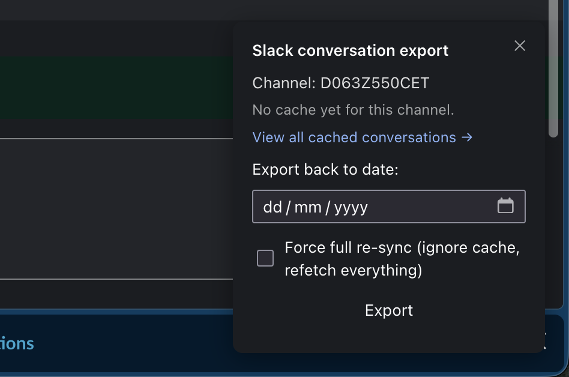

# slack-extractor

Export a Slack conversation's message history to a JSON file, straight from your browser — no bot setup, no API token, no build step.



## Features

- Zero dependencies, zero build step — plain JavaScript that runs in the browser
- No Slack app / bot token to create — reuses the token from your already-logged-in Slack web session
- Two ways to run it: a one-off DevTools console script, or an installable browser extension
- Extension mode adds a local per-conversation cache with incremental sync (only fetches what's new since the last export)
- Handles pagination and Slack API rate limiting (`429` + `Retry-After`) automatically
- Export as raw JSON, or as a self-contained HTML file styled to resemble the Slack UI (see below)

## How it works

Both the console script and the extension work the same way:

1. They read your Slack session token out of `localStorage` (`localConfig_v2`), the same token the Slack web app itself uses.
2. They extract the current channel/DM ID from the page URL.
3. They call Slack's internal `conversations.history` endpoint directly, paging backward in time (200 messages per page) and deduplicating messages by timestamp (`ts`), until either the conversation's full history is exhausted or the date you chose is reached.
4. The collected messages are sorted ascending by timestamp and written out as a downloaded JSON file.

**Limitations:**

- Only top-level channel/DM messages are fetched — thread replies are explicitly excluded (`ignore_replies: true`).
- No separate channel list, user list, or file/attachment download step — you get whatever is embedded in the raw Slack message objects.
- Only works on `app.slack.com` (not self-hosted / Enterprise Grid domains outside that host).
- You must have the target conversation open and be logged into Slack in that browser tab.

## Installation & usage

### Option B — Browser extension (`extension/`)

Loads the same exporter as an unpacked extension, plus a caching layer.

**Chrome:**

1. Go to `chrome://extensions`.
2. Enable **Developer mode** (top right).
3. Click **Load unpacked** and select the [`extension/`](extension/) folder.

**Firefox:**

1. Go to `about:debugging#/runtime/this-firefox`.
2. Click **Load Temporary Add-on…** and select [`extension/manifest.json`](extension/manifest.json).
   (Firefox removes temporary add-ons on restart — reload after each browser restart.)

**Usage:**

1. Open a conversation at `app.slack.com`.
2. Click the extension's toolbar icon to toggle the export panel.
3. Pick a date and a **Format** (JSON or HTML), then click **Export**. By default this only fetches messages newer/older than what's already cached; check **Force full re-sync** to ignore the cache and refetch everything.
4. Click **View all cached conversations →** to open the cache manager (`manager.html`), which lists every cached conversation with its message count, date range, and cache size, and lets you download (as JSON or HTML) or clear each one individually.

## Output format

Exports are downloaded as a single file — there is no CSV/SQLite output, and files are saved wherever your browser's default downloads location is (the tool doesn't create its own output folder structure). Both the panel and the cache manager offer two formats:

- **JSON** — the raw data, as below.
- **HTML** — a self-contained page with the same raw JSON embedded (in a `<script type="application/json">` tag) plus CSS/JS that renders it as a Slack-style conversation view: grouped messages, avatars (initials, since user profile images aren't fetched by this tool — bot/webhook icons render if present in the raw data), reactions, image/file thumbnails, call cards, and thread reply counts. It has no dependency on the extension or a live Slack session once downloaded, though private Slack-hosted image/file thumbnails only load if you're also logged into Slack in the browser you open it in. Since thread replies aren't fetched (see Limitations below), threads show a reply count only, not the replies themselves.

### Panel export (console script or extension panel)

```json
{
  "channel": "C0123456789",
  "exportedUntil": "2026-01-15",
  "messageCount": 842,
  "messages": [
    /* raw Slack message objects, ascending order by ts */
  ]
}
```

Filename: `slack-export_<sanitized-conversation-title>_<channelId>_until-<yyyy-mm-dd>.<json|html>`

### Cache manager export (extension only)

Downloads the full raw cache for a conversation (not bounded by a chosen date):

```json
{
  "channel": "C0123456789",
  "cachedFrom": "1/1/2026",
  "cachedThrough": "1/15/2026",
  "messageCount": 842,
  "messages": [
    /* raw Slack message objects, ascending order by ts */
  ]
}
```

Filename: `slack-export-cache_<sanitized-conversation-title>_<channelId>.<json|html>`

## Requirements

- A modern Chromium or Firefox browser
- An active, logged-in Slack session at `app.slack.com`
- No Node/Python runtime, package manager, or build tooling needed
